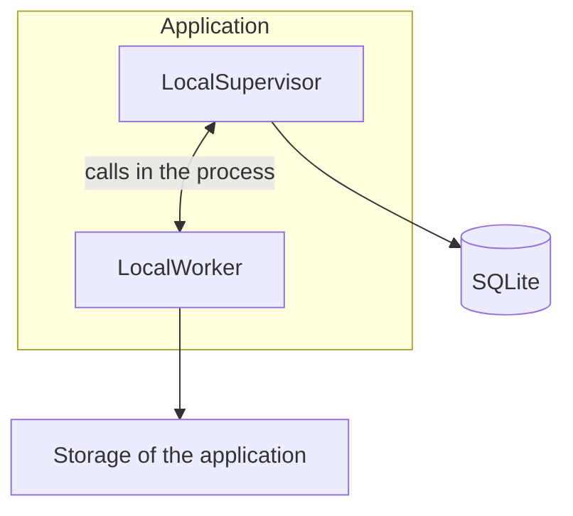
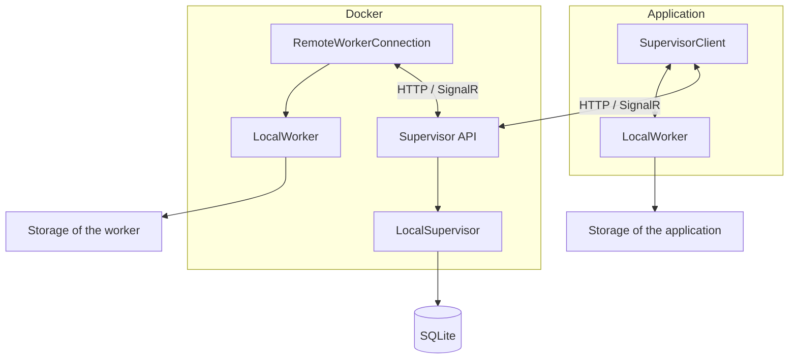
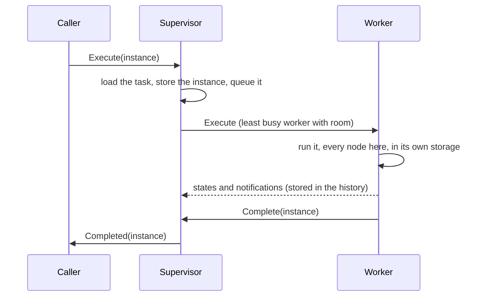
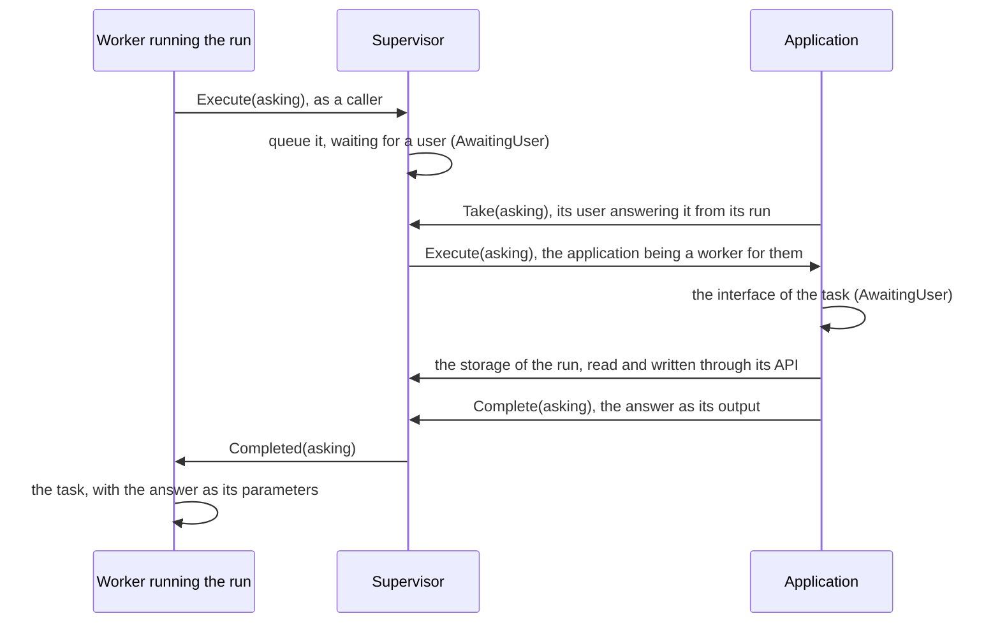
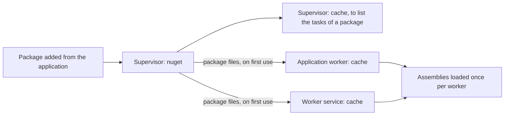

# Architecture

The standalone and remote modes run the same code: one supervisor (`LocalSupervisor`) and one kind of worker (`LocalWorker`). A remote supervisor only adds an HTTP/SignalR layer between them, and a remote worker only adds a hub connection.

Two rules keep the interactions simple:
- What the application starts runs in the application, unless the user starts it on the workers. The workers run what the supervisor dispatches to them: the schedules, and the runs started on them from the application.
- Once a worker (the application's included) starts an execution, everything of it stays there. Every node of a workflow runs where the workflow runs, and its tables and files never leave the storage of its run. A suspended run is resumed by whoever can reach that storage (see [Suspended runs](#suspended-runs)).
- The one exception is a task asking the user: the asking always runs in an application, where the user is. A worker hands it to one through the supervisor (see [User interface tasks](#user-interface-tasks)).

## Standalone and remote

In standalone mode, the supervisor runs inside the application, and the application is its only worker.



In remote mode, the application reaches the supervisor through its API, and the supervisor dispatches to the remote workers.



| | Standalone | Remote |
| --- | --- | --- |
| Supervisor | `LocalSupervisor` in the application | `LocalSupervisor` behind `Fantoche.Supervisor.Api`, reached with `SupervisorClient` |
| Transport | Calls in the process, messages copied as over the wire | HTTP for the data, SignalR hubs for the executions and the history |
| Workers the supervisor dispatches to | The application | The worker services (`Fantoche.Worker.Service`) |
| A workflow started from the application | Runs in the application, or through the supervisor on the application's own worker ("On remote worker") | Runs in the application, or on the worker services ("On remote worker") |

Both supervisors implement `ISupervisor`, which is all the application and the workers know of them. That is why the mode only changes how the application is built (`SpineViewModel.AddServices`), never what it does.

In the process, the messages are copied the way the wire would copy them (`FantocheJson.Copy`). The caller and the worker never share an instance, so a bug can't hide in one mode only.

## An execution dispatched to a worker

An execution is handed whole to the supervisor, and the worker it is dispatched to runs all of it. A caller waiting on its outcome hands it over with `ICallerHub.Execute` (what `RemoteTaskExecutor` calls, for a task asking the user); a run nobody waits on but the history (a schedule, a workflow started "On remote worker") is started with `IDispatchService.StartAsync` (`POST /dispatch/tasks/{id}/start`, `Dispatcher.StartAsync`):



- Only JSON travels: the parameters and the output. A table or file the output points at stays in the storage of its run.
- A worker lost while running an execution leaves it suspended. A worker that reconnects meanwhile can't report on it anymore: its states are dropped.
- A worker registers with its roles (`EnumWorkerRoles`): the worker services take runs, up to their capacity. The applications take the tasks asking the user, as many as come, since those wait on the user rather than on a slot. In standalone mode the application takes both.
- A workflow started from the editor is only sent to the workers when the user asks for it in its start settings ("On remote worker"). These settings only show for a workflow expecting parameters: one taking none starts right away, in the application.
- A run that can't be loaded (`Dispatcher.StartAsync`) is stored as a failed run: nobody waits on it to be told.

### Why a single node is never sent to a worker

Sending a single node of a workflow to a worker was implemented, then removed. Each worker only reads its own storage, so the tables and files a node needed had to travel with it, through a transit held by the supervisor:
- the caller put the items the parameters pointed at in the transit, the worker took them into its storage, and the output came back the same way;
- the items were found by their ids anywhere in the JSON, and kept their ids once copied, so the `TableRef` and `FileRef` stayed valid;
- each side emptied the transit as it took the items, and the supervisor cleared it when a caller disconnected or when it started.

It worked, but it took a transit store in the supervisor, an HTTP API to stream it, a copy of every table a node read or wrote, and the cleanup of what a lost execution left behind. Few workflows need a node of theirs elsewhere, and such a node can be made a workflow of its own.

A "Run on a worker" setting on the tasks and workflows was removed too. Where an execution runs belongs to what starts it, not to the task or workflow itself: a schedule always runs on the workers, and a run started by hand runs in the application, close to the editor and the local files, unless the user chooses otherwise as they start it.

## Following a run

- The history of a task, workflow or scope only lists the runs started on their own (`IHistoryService.GetByScopedAsync`, `ParentInstanceId` empty). A node of a workflow is read from its run.
- The detail of an execution shows what it ran with, its output (or the error it failed with) and the executions it ran. It only reads: a run of a workflow is acted upon from its editor ("Open execution").
- The editor draws a run on the graph of its workflow, as the history holds it, then as it goes on (`WorkflowRunViewModel`). From there it is paused, stopped and resumed, and its tasks asking the user answered (see [Suspended runs](#suspended-runs)). Double-clicking a node shows the detail of its execution, or opens the window asking the user when it waits for them.

## Suspended runs

A run nothing runs anymore, waiting to be resumed, is `Suspended`. Its output tells why:
- **Paused by the user** from the editor: the nodes it runs finish, no other task starts (the controls still pass, so a run whose tasks are over reaches its end), and its nested runs pause with it. Nothing runs twice.
- **Cut short** by a crash or a lost worker: the nodes it was running run again once resumed.

It is resumed by hand from the editor, the run opened on the graph of its workflow ("Resume"), or stopped instead, which cancels it for good. The editor pauses, stops and resumes a run through whoever runs it:
- a run of the application (`TaskInstance.ApplicationId` set) through `IExecutionService`;
- a run the supervisor dispatched through `IDispatchService` (`POST /dispatch/runs/{id}/pause`, `/cancel`, `/resume`). The supervisor passes a pause or a stop on to the worker running it (`IWorkerClient.Pause`, `IWorkerClient.Cancel`), which pauses it the way the application does. A run still waiting for a worker is suspended or canceled right away.

| A run started by | Is cut short when | Is resumed by |
| --- | --- | --- |
| The application | The copy of the application running it is gone. Any copy checks when it starts | Any copy of the application on the same machine (`TaskInstance.ApplicationId`, the machine name) |
| The supervisor (dispatched) | Its worker is lost, or the supervisor running it is gone (checked when a supervisor starts), or the application running one of its tasks asking the user is lost | The supervisor, on any worker with room |

Several copies of the application can run side by side on a machine:
- Each process running executions (a copy of the application, a supervisor) holds a lock file for as long as it lives (`RunnerSessions`), and marks its runs with its session (`TaskInstance.SessionId`). A run whose session holds no lock anymore was left behind.
- A run is taken atomically as it is resumed (`IHistoryService.ClaimRunAsync`): two copies resuming it at once can't both run it.
- In standalone mode, the copies share the database, but the history is only pushed live within a copy: another copy's runs show once the page is read again.

Resuming walks the run again from its history (`WorkflowExecutor`, with `WorkflowInstance.StoredInstances`):
- A node that was running runs again from its start, with the parameters it was given. Every task can run more than once after a crash, so a task with side effects has to bear it. A pause lets the nodes finish, so nothing runs twice.
- A completed node is kept. Its next nodes that were never reached run.
- A join still waiting keeps the branches that already arrived (`TaskInstance.PreviousIds` holds them), and waits for the others.
- A nested workflow resumes from its own history.
- A run that reached its end is only closed.

What the history stores for this:
- Each instance stores the ids of the instances it carries on from (`PreviousIds`) and the shared context it was given. Pass-through nodes and loops are walked again from these links.
- The run stores its global context, the version of the graph it ran (`TaskInstance.WorkflowVersion`) and the version of every workflow nested in it (`TaskInstance.NestedVersions`).
- A run resumes on these versions, whatever the workflows became since (see [Workflow versions](#workflow-versions)). The tasks are read as they are now: a resumed node runs the package its task points at today, the newest version for a task following the latest one (see [Packages and caches](#packages-and-caches)).

A remote run carries on in the storage of its first worker, so the workers share their storage (`STORAGE_FOLDER`).

The executions still live in memory only (`ExecutionService`, `Dispatcher` and `WorkerSession` keep a handle on each running one, to cancel it or send it back to its caller). Resuming doesn't need them: everything it reads is in the history.

## Workflow versions

Each save that changes the graph of a workflow adds a version (`AutomationWorkflow.Version`), and every instance of a workflow keeps the version it ran (`TaskInstance.WorkflowVersion`), a run also keeping the versions of its nested workflows. A run opened from the history is drawn on its own version, read only, and resumed on it. It isn't opened while the graph holds unsaved changes: they are saved or undone first.

The versions are stored as reverse diffs, so a past version costs only what changed:

| Table | Holds |
| --- | --- |
| `GraphNodes`, `GraphConnectors`, `GraphConnections` | The latest version, read as it is |
| `GraphVersions` | One row per version. The latest has no changes; every older one keeps what turns the version after it back into itself: the nodes that changed (stored whole, with their connectors, `null` for one that didn't exist) and the connections added or removed |

- A past version is rebuilt from the latest one, applying the changes of each version back down to it (`IScopedService.GetVersionAsync`). The most recent ones, the most opened, are the cheapest.
- A save leaving the graph as it is (only the name or the settings changed) adds no version.
- Moving a node is a change: the version stores that node again.
- The versions of a workflow go with it when it is removed. Nothing else removes them yet: pruning one would mean merging its changes into the version before.

## User interface tasks

Any task can ask the user for its parameters before it runs, and any task is set up in the editor. A task or a workflow started or scheduled on its own is given its parameters too. All of them show the interface of the element: a WPF view from a package of interfaces, or the form generated from its parameters. A workflow only asks where the node of the task is given an "ask the user" node, so the same task runs unattended elsewhere (a schedule, an automated run).

- **In a workflow:** "Ask the user" on a task node adds a round node attached under it, through the diamond under the task (`GraphUserInterface`, `BaseGraphTask.UserInterface`). It points at the same task and sits apart from the branches: nothing flows into it nor out of it. A task is asked by one node, which asks for that task only (`TasksGraph.CanConnect`).
- **An interface is an element of the tree** (`AutomationInterface`, pointing at a class implementing `ITaskInterface`), shown like a task. It is linked to a task or a workflow by hanging under it: the tree then shows it as the child of the element, and an element linked to none has no child. "Add an interface" with a task or workflow selected links it to that element; its details link it to another one or unlink it.
- **The generated form** is an element of its own too, built in, in the controls scope with the start and the end (`AutomationInterface.Form`).
- **Which one a task or workflow uses:** the "Interface" of its settings picks it (`TaskSettings.InterfaceId`): the default, the generated form, or one of the interfaces hanging under it. The default is the interface hanging under it, the generated form when it has none. A pick that can't be shown anymore (unlinked, removed, without a class) falls back on the default (`AutomationInterface.Pick`). Read from the tree when a workflow is loaded to run or to edit, and as an element is started or scheduled (`ScopedServiceExtensions.ResolveInterfacesAsync`, into `BaseAutomationTask.Interface`, which isn't stored), and carried with the task to the application asking.
- **From the tree to a graph:** an interface dropped on the graph asks the user for its task. Dropped on a node of that task, it is attached under it; dropped elsewhere, under the only node of the task not asking yet, or on its own when there are none or several (`WorkflowEditorViewModel.AskWith`). The form asks for the task of the node it is dropped on. An interface linked to no task asks for none, and one linked to a workflow is shown as the workflow starts.
- **When the task is reached:** its parameters are resolved, an instance of the asking node shows the interface of the task with them (`TaskInstance.AsksUser`, `AskingWindow`), and the task runs with what the user answered, carrying on from the node before it (`WorkflowExecutor.RunUiAsync`). A resume asks again a task that was asking, and runs the task with the answer kept when it was answered but the task never started.
- **In the editor:** the settings of a node (`TaskSettingsViewModel`) show what the node reads, the mapping and the schema of its task side by side. The mapping is edited with the interface of its task or nested workflow when it handles `EnumInterfaceMode.Setup` (`NodeInterface`), in place of the generated form, so what the node reads and expects stays in sight. Either way the mapping is checked by `MappingCheck` and undone like any edit: the form as it is edited, the interface once its answer is confirmed.
- **Started or scheduled on its own:** the start settings of a workflow and the parameters of a schedule show the interface of the element when it handles `EnumInterfaceMode.Setup`, the generated form otherwise (`ParametersInput`). What the interface answers is checked against the schema of the parameters.

### The generated form

Without an interface, the parameters are filled in with Joufflu.Data's `DataForm`, built from the schema of the parameters (`SchemaTree`): in a run, as an element is started or scheduled (`ParametersFormView`), and in the settings of a node in the editor, where a field can point at what the node reads instead of holding a value. The schema is generated from the class of the parameters, so the attributes of its properties shape the form:

```csharp
public class ImportCsvParameters
{
    /// <summary>Path of the CSV file on the worker.</summary>      // the description, under the label
    [FilePath("CSV files|*.csv|All files|*.*")]                    // a file picker, the dialog showing the filter
    public string Path { get; set; } = "";

    [Range(1, int.MaxValue)]                                       // checked as it is typed : "At least 1."
    public int BatchSize { get; set; } = 10000;
}
```

- Read by the form: the XML summary or `[Description]`, `[Display(Name = ...)]` as the label, `[Required]`, `[Range]`, `[MinLength]`, `[MaxLength]`, `[RegularExpression]`.
- Fantoche's own (`FormInputs`, in `Fantoche.Plugins.Shared`): `[FilePath(filter)]` and `[Multiline]`, written in the schema as the `x-input` keys Joufflu.Data reads.
- The schema of a task is stored when the task is created from its class : a task created before an attribute was added keeps its former schema until it is created again.



A run started in the application skips the supervisor: the application asks itself.

Why a node of its own rather than a switch on the task (an `AskUser` input, as before): a workflow run unattended holds only the task, asking is seen as a step of the workflow, and the task runs on a worker while only the interface needs an application.

Why the interface is an element linked to a task rather than declared by the task class: every task asks with the generated form without anything to write, a user can link another interface to a task without rebuilding it, and the interfaces are packed apart. WPF only runs on Windows, while the workers load the tasks on any system.

Why WPF rather than HTML pages (as before): an interface is typed C# running in the application, calling the rules of its task directly, styled by the theme of the application, without a bridge in JavaScript.

### Writing an interface

A project for Windows (`net10.0-windows`, WPF) referencing `Fantoche.Plugins.Shared` and the project of its tasks. See `Fantoche.Plugins.Example.Ui`. The contract stays in `Fantoche.Plugins.Shared`, which the workers load on any system: it holds nothing of WPF, the view being handed as an object (`TaskInterfaces.ViewOf` checks it is a WPF element).

```csharp
[TaskInterface(typeof(MapColumnsTask))]          // the task it edits, see "Picking it"
public class MapColumnsInterface : ITaskInterface
{
    private MapColumnsViewModel? _columns;

    // The generated form shows in the modes it doesn't handle : here, outside a run. (The actual
    // MapColumnsInterface also handles Setup, with a view of its own, switching on context.Mode.)
    public bool Handles(EnumInterfaceMode mode) => mode == EnumInterfaceMode.Execution;

    public object Show(TaskInterfaceContext context)
    {
        _columns = new MapColumnsViewModel(context.ParametersAs<MapColumnsParameters>()!, context.Runtime!.Storage);
        _ = _columns.LoadAsync();
        return new MapColumnsView { DataContext = _columns };
    }

    public Task<JToken?> ReadAsync()
    {
        MapColumnsParameters answer = _columns!.Answer();
        // The rule of the task, not a copy : thrown, the message is shown and the user stays on it.
        if (MapColumnsTask.Check(answer) is string refusal)
            throw new TaskInterfaceException(refusal);
        return Task.FromResult<JToken?>(JToken.FromObject(answer));
    }
}
```

- **The modes:** `Execution` is a run: `Parameters` holds the parameters and `Runtime` what the rules of the task are handed (its storage first). `Setup` is outside a run, nothing having run: `Runtime` is null.
  - In the editor, `Parameters` holds the mapping, a field pointing at what the node reads holding a reference (`"$previous.Table"`), and `References` what the node reads, typed.
  - As a workflow or a task is started or scheduled, `Parameters` holds the parameters given so far (the defaults of the start of a workflow, the parameters of the schedule), and `References` is empty.
- **The answer:** the application checks it before taking it. In a run, it must read as the parameters of the task, else the refusal is shown above the buttons. In the editor, `MappingCheck` checks it as it checks the generated settings.
- **The view:** only what the user edits. The application shows the name of the node, the refusal and the buttons around it; in the editor, also what the node reads and the schema of its task on each side, the view taking the middle column. Joufflu, which the application holds and shares with it, gives it the controls, styles (`Card`, `GhostButton`...), brushes and icons of the application, following its theme; plain WPF controls take the theme too. Reference the Joufflu version of the application, no newer. The resources of the view stay in the view: put in the application, they would apply to every interface.
- **Packing it:** the package carries the assembly of the tasks it was built against. It doesn't carry what the application already holds (WPF, Joufflu, CommunityToolkit.Mvvm, Newtonsoft.Json, `Fantoche.Plugins.Shared`), which it shares with it. See `Fantoche.Plugins.Example.Ui.csproj`:

  ```xml
  <ProjectReference Include="..\Fantoche.Plugins.Example\Fantoche.Plugins.Example.csproj" PrivateAssets="all" />
  <Target Name="PackTasks" DependsOnTargets="ResolveReferences">
    <ItemGroup>
      <BuildOutputInPackage Include="@(ReferenceCopyLocalPaths)" Condition="'%(ReferenceCopyLocalPaths.Filename)%(ReferenceCopyLocalPaths.Extension)' == 'Fantoche.Plugins.Example.dll'" />
    </ItemGroup>
  </Target>
  ```

- **Picking it:** the package is added from the Packages page like any other. The supervisor doesn't look for tasks in a package built only for a platform (`PackageCache.IsPlatformOnly`): it may run on Linux, where WPF can't load. The details of an interface element pick its class ("Select interface"), listed by the application itself. `[TaskInterface(typeof(...))]` tells which task an interface edits: the samples link it to the tasks running that class (see [Samples](#samples)).

### Loading the interfaces

The application extracts the packages of interfaces for its own version of Windows (`PackageCache.WindowsFramework`), apart from the cache of its worker, and loads them (`TaskInterfaces`):

- **A context per version of a package**, holding the interface and the assembly of the tasks it carries. Two versions of an interface show side by side, each calling the rules of its own version of the tasks.
- **Never unloaded:** WPF keeps hold of the types it showed (the dependency properties, the XAML caches), so a context holding a view can't be collected. A version stays loaded until the application closes.
- **The assembly version changes with every version of the package.** WPF finds the XAML of a view by the name and the version of its assembly: two versions sharing one would show each other's views. The second one is refused. The SDK derives the assembly version from `<Version>`, but a prerelease (`1.1.0-beta`) and its release share `1.1.0.0`.
- **Built against what the application holds:** an interface referencing a newer `Fantoche.Plugins.Shared` or Joufflu than the application's doesn't load.
- **When it can't be shown**, the generated form is shown instead with the reason, in a run as in the editor: the parameters can still be answered.

### While a task asks

- **Where it runs:** always in an application (`UserTasks`).
  - A run of the application asks there.
  - A worker hands the asking to the supervisor as any caller does (`RemoteTaskExecutor`). The supervisor never hands it out on its own: it waits in the queue, `AwaitingUser` in the history, and the branch of the run with it.
  - A user answering it from its run takes it (`IWorkerRegistration.TakeAsync`): the supervisor hands it to that application (`EnumWorkerRoles.UserTasks`, which every application registers in both modes), and its window opens once it asks. A second application taking it is refused. Nothing shows up unasked.
  - A worker reaching no application at all (no supervisor) fails the asking, and its task never runs.
- **While it asks:** the asking node is `AwaitingUser` and the branch of its task waits, the rest of the run going on.
  - The worker keeps the run in memory meanwhile, and counts it against its capacity.
  - For a run of the application, the editor following the run opens the window by itself. Otherwise the application tells the user, who opens the run on the graph of its workflow (from its history, or the detail of the execution) and double-clicks the node waiting.
  - The run shows `AwaitingUser` in the history while a node under it waits, nested runs included, and goes back to `Progressing` once none does (`LocalHistoryService.CarryAwaitingUserUpAsync`). Answering takes the task itself, not the nested runs holding it.
  - Only the application showing it can answer it. A second answer is refused.
- **When it goes wrong:**
  - An application lost while asking leaves the node `Suspended`, and its run with it. Resuming the run asks again.
  - A run canceled stops the asking and closes its window.
- **Files and tables:** the interface reads them through the storage of the run (`context.Runtime.Storage`), a slice of rows at a time for a table (`ReadPageAsync`). For a run of the workers, the application reaches that storage through the supervisor (`RemoteStorage`), which reads the volume the workers share. The queries run there, only their results travel.
- **What an interface can reach:** it runs in the application with the rights of the application, as the tasks the application loads already do. Nothing sandboxes it, as the HTML pages were: a package of interfaces is trusted as much as a package of tasks.

## Samples

A fresh database only holds the root scope and the controls (`DatabaseSeeder`). The samples come with the packages they run, created by the application once the package is added from the Packages page (`ExampleSamples`, `PackageSamples`):

- **`Fantoche.Plugins.Example`:** a task per class of the package, in a scope named after it, named after the class ("Import csv") and following its newest version. Their schemas are generated from the classes, as for any task, rather than written by hand. Then the "Customers and orders" workflow running them, when the package holds every task it needs.
- **`Fantoche.Plugins.Example.Ui`:** an interface element under each task running the class an interface declares (`[TaskInterface]`), unless the task has one already. Added first, it waits for the example package, which links them when it is added.
- Adding a package again (another version) creates only what is missing: a task is found by its class, wherever the user moved it.

## What the editor previews of a task

The editor walks the graph without running it (`GraphExecutionPreview`) : a task hands over the sample of its output schema, which knows nothing of the data. A task handing over part of its input says so on the property of its input (`OutputPreview`), so the nodes after it read what that property resolved to :

```csharp
public class MapColumnsParameters
{
    [JsonSchemaExtensionData(OutputPreview.SchemaKey, OutputPreview.Whole)]        // the output is this table...
    public TableRef Source { get; set; } = new();

    [JsonSchemaExtensionData(OutputPreview.MappingSchemaKey, OutputPreview.Whole)] // ...with these names in its mapping
    public List<ColumnMapping> Columns { get; set; } = [];
}
```

- Without it, `$previous.Mapping.CustomerId` after the mapping is an error in the editor, and isn't offered.
- The task has to hand over what it declares : the preview trusts it, the run doesn't check it.
- The value is the place in the output : a property name, or `""` for the output itself. Values handed over to the same place merge, the mappings of the two tables of a merge for instance.

See [the table tasks](Fantoche/Fantoche.Plugins.Example/readme.md) for the mapping of the columns these previews serve.

## Schedules

- A task or workflow holds its schedules (`BaseAutomationTask.Schedules`): a standard cron (`minute hour day-of-month month day-of-week`, read in local time) and the parameters each run starts with, checked against its input schema.
- They're edited in its Schedules tab, each change saved right away. The Scheduler page lists them all and lays out their runs over the next 7 days, hour by hour, to see where they pile up.
- The supervisor starts them (`Scheduler`), checking every minute what came due and dispatching it to its workers like any dispatched run: it can be suspended, resumed on any worker, and nobody waits on it but the history. A scheduled workflow that can't be loaded is stored as a failed run.
  - The cron is read in the time zone of the supervisor: set `TZ` on its container, or the schedules start in UTC while the Scheduler page shows them in the time of the user.
  - What came due while no supervisor ran is skipped, not caught up.
  - Every supervisor sharing the database (copies of the application in standalone mode) checks the schedules; each time a schedule comes due is claimed in the database first (`ScheduledStarts`), so a single one starts it. The claims are cleaned up with the history.
  - In standalone mode the application is the supervisor, so its schedules only run while it is open, on its own worker.

## Storage and cleanup

Each execution has its own storage folder. The nodes of a workflow write into the folder of its run.

```text
storage/
  {taskId}/
    {created}-{instanceId}/
      tables/t_{id}.parquet
      files/f_{id}/{name}
```

- The remote workers share one storage folder (`STORAGE_FOLDER`, a volume mounted in every worker and in the supervisor). The application keeps its own.
- The executions are kept for a month. Once a day, the supervisor removes the older ones: the folder of each run in the storage it is given (`STORAGE_FOLDER`, or the storage of the application in standalone mode), then the runs themselves (their instances go with them).
- In remote mode the supervisor can't reach the storage of the application: when it starts, the application removes its folders whose run the history doesn't hold anymore. A folder whose name doesn't follow the pattern is left alone.
- The supervisor serves the storage it reaches under `storage/runs/{runId}` (`StorageApi`): what an application running a task asking the user reads and writes of a run of the workers.

A table or file named in the history therefore only exists in the storage that execution wrote to, and only for a month.

## Workers and pending executions

The supervisor keeps its executions in memory only, so it pushes what it dispatches rather than storing it (`ISupervisor.Dispatch`):
- The `Dispatcher` raises `StatusChanged` with the whole status whenever a worker comes or goes, or an execution is queued, handed out or over.
- In remote mode, the supervisor API pushes it on the `hubs/dispatch` hub, and `GET /dispatch/status` reads it. After a reconnection, the client reads it again: what was pushed meanwhile is lost.
- The Workers page reads the status once when shown, then follows the changes until hidden. It shows each worker with what it runs, and the executions waiting for room, in the order they will be handed out.
- The application is always listed first. Its executions started in the application run on its own worker without going through the supervisor, so the page reads them from the execution service (`IExecutionService.RunningChanged`). The application is also a worker of the supervisor, for the tasks asking the user (and for the runs in standalone mode): both are shown as one row.

## Packages and caches

The supervisor holds the packages. Each worker downloads a package the first time a task needs it, and extracts it in its own cache:



- A task points at a package and a version, or at no version to follow the latest one (`PackageIdentifier.Version` null, "Latest" when the class is picked, and the default). The newest version is asked to the supervisor each time the task runs (`PackageCache.DownloadPackageAsync`, `IPackageSource.GetVersionsAsync`), never cached, so a version added since the last run is picked up without editing the task. The samples follow the latest version of the example plugins.
- A cache never refreshes a version it already extracted, so a version can't be added twice. Publish a changed package under a new version.
- The supervisor's cache only serves to check what a package holds when it is added. The tasks themselves always run from the cache of a worker, in both modes.
- A package of interfaces, built for Windows, is only extracted by the application, in a cache of its own (see [Loading the interfaces](#loading-the-interfaces)).

## Folders

```text
Supervisor (DATA_FOLDER, or %AppData%/Automation in standalone mode)
  fantoche.db       database: scopes, tasks, workflows, history
  nuget/            the packages added
  cache/            the packages extracted to check what they hold

Worker (DATA_FOLDER, or %AppData%/Automation/worker for the application)
  cache/            the packages extracted to run the tasks
  storage/          the storage of its executions

Application (%AppData%/Automation)
  interfaces/       the packages of interfaces extracted to show them
```
