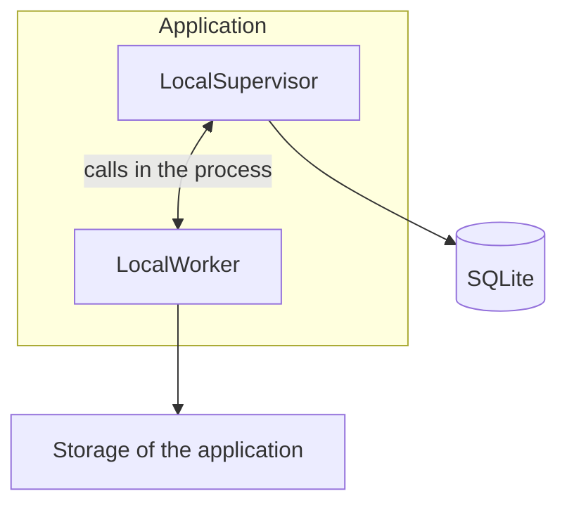
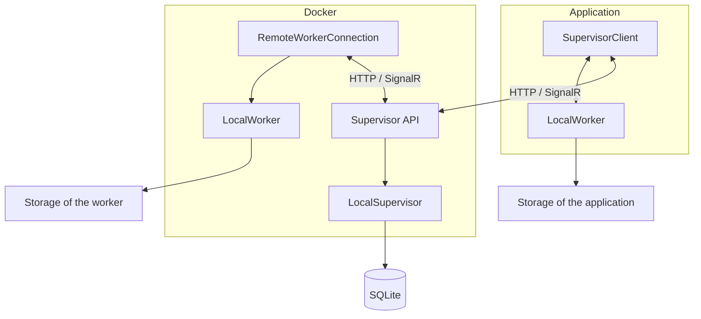
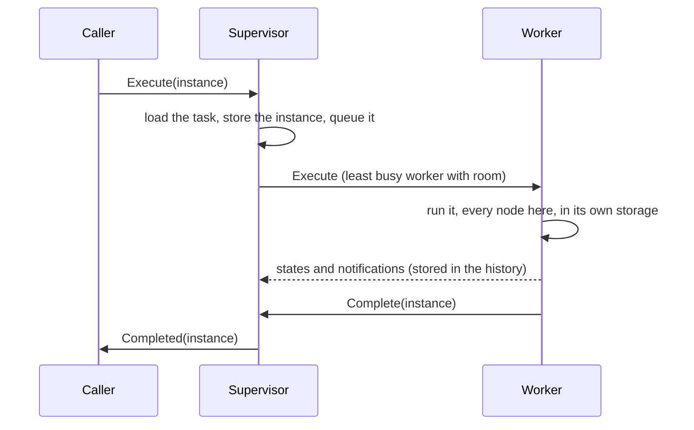
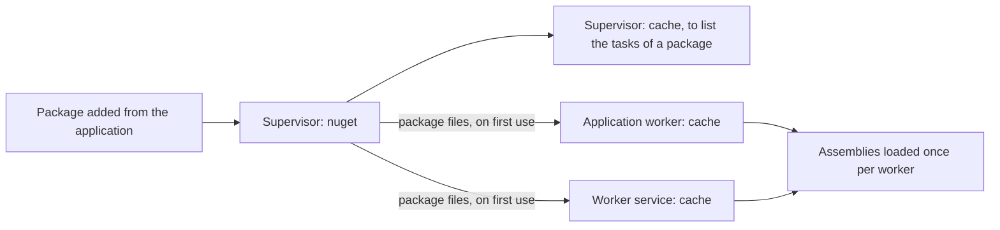

# Architecture

The standalone and remote modes run the same code: one supervisor (`LocalSupervisor`) and one kind of worker (`LocalWorker`). A remote supervisor only adds an HTTP/SignalR layer between them, and a remote worker only adds a hub connection.

Two rules keep the interactions simple:
- What the application starts runs in the application. The workers run what the supervisor dispatches to them: the scheduled items (to come).
- Once a worker (the application's included) starts an execution, everything of it stays there. Every node of a workflow runs where the workflow runs, and its tables and files never leave the storage of its run.

## Standalone and remote

In standalone mode, the supervisor runs inside the application, and the application is its only worker.



In remote mode, the application reaches the supervisor through its API, and the supervisor dispatches to the remote workers.



| | Standalone | Remote |
| --- | --- | --- |
| Supervisor | `LocalSupervisor` in the application | `LocalSupervisor` behind `Fantoche.Supervisor.Api`, reached with `SupervisorClient` |
| Transport | Calls in the process, messages copied as over the wire | HTTP for the data, SignalR hubs for the executions and the history |
| Workers the supervisor dispatches to | The application | The worker services (`Fantoche.Worker.Service`) |
| A task or workflow started from the application | Runs in the application | Runs in the application |

Both supervisors implement `ISupervisor`, which is all the application and the workers know of them. That is why the mode only changes how the application is built (`SpineViewModel.AddServices`), never what it does.

In the process, the messages are copied the way the wire would copy them (`FantocheJson.Copy`). The caller and the worker never share an instance, so a bug can't hide in one mode only.

## An execution dispatched to a worker

An execution is handed whole to the supervisor (`ICallerHub.Execute`, what `RemoteTaskExecutor` calls), and the worker it is dispatched to runs all of it:



- Only JSON travels: the parameters and the output. A table or file the output points at stays in the storage of the worker that wrote it.
- Nothing in the application dispatches yet: the scheduled items will.

### Why nothing started by hand is sent to a worker

Sending a single node of a workflow to a worker was implemented, then removed. Each worker only reads its own storage, so the tables and files a node needed had to travel with it, through a transit held by the supervisor:
- the caller put the items the parameters pointed at in the transit, the worker took them into its storage, and the output came back the same way;
- the items were found by their ids anywhere in the JSON, and kept their ids once copied, so the `TableRef` and `FileRef` stayed valid;
- each side emptied the transit as it took the items, and the supervisor cleared it when a caller disconnected or when it started.

It worked, but it took a transit store in the supervisor, an HTTP API to stream it, a copy of every table a node read or wrote, and the cleanup of what a lost execution left behind. Few workflows need a node of theirs elsewhere, and such a node can be made a workflow of its own.

A "Run on a worker" setting on the tasks and workflows, sending a whole execution started from the application to a worker, was removed too. A run started by hand is for building and checking a workflow, close to the editor and the local files. Where an execution runs belongs to what schedules it, not to the task or workflow itself.

## Schedules

- A task or workflow holds its schedules (`BaseAutomationTask.Schedules`): a standard cron (`minute hour day-of-month month day-of-week`, read in local time) and the parameters each run starts with, checked against its input schema.
- They're edited in its Schedules tab, each change saved right away. The Scheduler page lists them all and lays out their runs over the next 7 days, hour by hour, to see where they pile up.
- Nothing runs them yet: the supervisor will dispatch them to the workers.

## Storage and retention

Each worker, the application's included, keeps one storage folder per execution it runs. The nodes of a workflow write into the folder of its run.

```text
storage/
  {taskId}/
    {created}-{instanceId}/
      tables/t_{id}.parquet
      files/f_{id}/{name}
```

Only the last executions of each task or workflow keep their folder: 10 by default, set on the task or the workflow ("Executions keeping their storage", `TaskSettings.StorageRetention`). Each worker applies this to its own folders:
- The older folders are deleted when an execution ends, but never the folder of an execution still running.
- The count is taken from the task or workflow the execution started from, wherever it runs.

A table or file named in the history therefore only exists on the worker that wrote it, and only while it is within the retention count.

## Workers and pending executions

The supervisor keeps its executions in memory only, so it pushes what it dispatches rather than storing it (`ISupervisor.Dispatch`):
- The `Dispatcher` raises `StatusChanged` with the whole status whenever a worker comes or goes, or an execution is queued, handed out or over.
- In remote mode, the supervisor API pushes it on the `hubs/dispatch` hub, and `GET /dispatch/status` reads it. After a reconnection, the client reads it again: what was pushed meanwhile is lost.
- The Workers page reads the status once when shown, then follows the changes until hidden. It shows each worker with what it runs, and the executions waiting for room, in the order they will be handed out.
- The application is always listed first. Its executions started in the application run on its own worker without going through the supervisor, so the page reads them from the execution service (`IExecutionService.RunningChanged`). In standalone mode, the application is also the supervisor's worker: both are shown as one row.

## Packages and caches

The supervisor holds the packages. Each worker downloads a package the first time a task needs it, and extracts it in its own cache:



- A cache never refreshes a version it already extracted, so a version can't be added twice. Publish a changed package under a new version.
- The supervisor's cache only serves to check what a package holds when it is added. The tasks themselves always run from the cache of a worker, in both modes.

## Folders

```text
Supervisor (DATA_FOLDER, or %AppData%/Automation in standalone mode)
  fantoche.db       database: scopes, tasks, workflows, history
  nuget/            the packages added
  cache/            the packages extracted to check what they hold

Worker (DATA_FOLDER, or %AppData%/Automation/worker for the application)
  cache/            the packages extracted to run the tasks
  storage/          the storage of its executions
```
