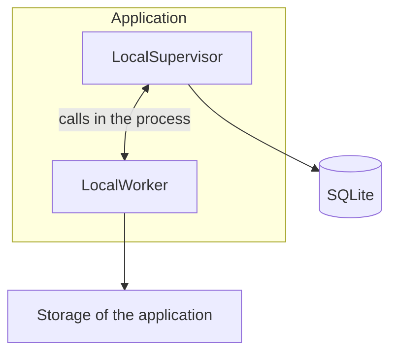
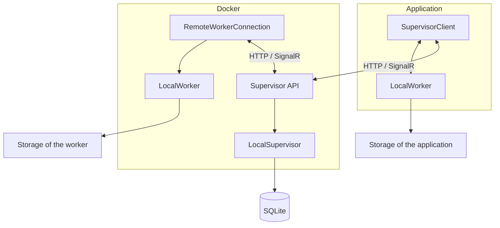
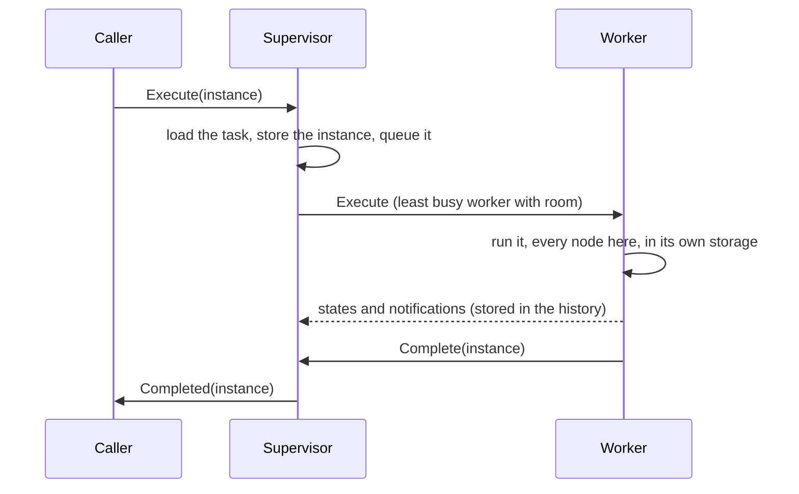
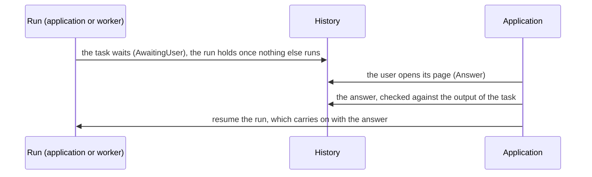
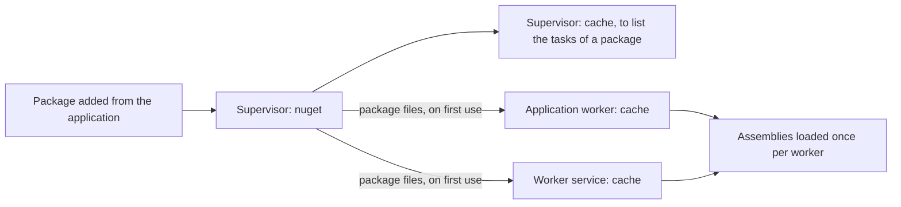

# Architecture

The standalone and remote modes run the same code: one supervisor (`LocalSupervisor`) and one kind of worker (`LocalWorker`). A remote supervisor only adds an HTTP/SignalR layer between them, and a remote worker only adds a hub connection.

Two rules keep the interactions simple:
- What the application starts runs in the application. The workers run what the supervisor dispatches to them: the scheduled items (to come).
- Once a worker (the application's included) starts an execution, everything of it stays there. Every node of a workflow runs where the workflow runs, and its tables and files never leave the storage of its run. A suspended run is resumed by whoever can reach that storage (see [Suspended runs](#suspended-runs)).

## Standalone and remote

In standalone mode, the supervisor runs inside the application, and the application is its only worker.



In remote mode, the application reaches the supervisor through its API, and the supervisor dispatches to the remote workers.



| | Standalone | Remote |
| --- | --- | --- |
| Supervisor | `LocalSupervisor` in the application | `LocalSupervisor` behind `Fantoche.Supervisor.Api`, reached with `SupervisorClient` |
| Transport | Calls in the process, messages copied as over the wire | HTTP for the data, SignalR hubs for the executions and the history |
| Workers the supervisor dispatches to | The application | The worker services (`Fantoche.Worker.Service`) |
| A task or workflow started from the application | Runs in the application | Runs in the application |

Both supervisors implement `ISupervisor`, which is all the application and the workers know of them. That is why the mode only changes how the application is built (`SpineViewModel.AddServices`), never what it does.

In the process, the messages are copied the way the wire would copy them (`FantocheJson.Copy`). The caller and the worker never share an instance, so a bug can't hide in one mode only.

## An execution dispatched to a worker

An execution is handed whole to the supervisor (`ICallerHub.Execute`, what `RemoteTaskExecutor` calls), and the worker it is dispatched to runs all of it:



- Only JSON travels: the parameters and the output. A table or file the output points at stays in the storage of its run.
- A worker lost while running an execution leaves it suspended. A worker that reconnects meanwhile can't report on it anymore: its states are dropped.
- Nothing in the application dispatches yet: the scheduled items will.

### Why nothing started by hand is sent to a worker

Sending a single node of a workflow to a worker was implemented, then removed. Each worker only reads its own storage, so the tables and files a node needed had to travel with it, through a transit held by the supervisor:
- the caller put the items the parameters pointed at in the transit, the worker took them into its storage, and the output came back the same way;
- the items were found by their ids anywhere in the JSON, and kept their ids once copied, so the `TableRef` and `FileRef` stayed valid;
- each side emptied the transit as it took the items, and the supervisor cleared it when a caller disconnected or when it started.

It worked, but it took a transit store in the supervisor, an HTTP API to stream it, a copy of every table a node read or wrote, and the cleanup of what a lost execution left behind. Few workflows need a node of theirs elsewhere, and such a node can be made a workflow of its own.

A "Run on a worker" setting on the tasks and workflows, sending a whole execution started from the application to a worker, was removed too. A run started by hand is for building and checking a workflow, close to the editor and the local files. Where an execution runs belongs to what schedules it, not to the task or workflow itself.

## Suspended runs

A run nothing runs anymore, waiting to be resumed, is `Suspended`. Its output tells why:
- **Paused by the user** from the editor: the nodes it runs finish, no other task starts (the controls still pass, so a run whose tasks are over reaches its end), and its nested runs pause with it. Nothing runs twice.
- **Cut short** by a crash or a lost worker: the nodes it was running run again once resumed.

It is resumed by hand, from the editor or from the detail of the execution ("Resume"), or stopped instead, which cancels it for good.

| A run started by | Is cut short when | Is resumed by |
| --- | --- | --- |
| The application | The copy of the application running it is gone. Any copy checks when it starts | Any copy of the application on the same machine (`TaskInstance.ApplicationId`, the machine name) |
| The supervisor (dispatched) | Its worker is lost, or the supervisor running it is gone (checked when a supervisor starts) | The supervisor, on any worker with room |

Several copies of the application can run side by side on a machine:
- Each process running executions (a copy of the application, a supervisor) holds a lock file for as long as it lives (`RunnerSessions`), and marks its runs with its session (`TaskInstance.SessionId`). A run whose session holds no lock anymore was left behind.
- A run is taken atomically as it is resumed (`IHistoryService.ClaimRunAsync`): two copies resuming it at once can't both run it.
- In standalone mode, the copies share the database, but the history is only pushed live within a copy: another copy's runs show once the page is read again.

Resuming walks the run again from its history (`WorkflowExecutor`, with `WorkflowInstance.StoredInstances`):
- A node that was running runs again from its start, with the parameters it was given. Every task can run more than once after a crash, so a task with side effects has to bear it. A pause lets the nodes finish, so nothing runs twice.
- A completed node is kept. Its next nodes that were never reached run.
- A join still waiting keeps the branches that already arrived (`TaskInstance.PreviousIds` holds them), and waits for the others.
- A nested workflow resumes from its own history.
- A run that reached its end is only closed.

What the history stores for this:
- Each instance stores the ids of the instances it carries on from (`PreviousIds`) and the shared context it was given. Pass-through nodes and loops are walked again from these links.
- The run stores its global context, the version of the graph it ran (`TaskInstance.WorkflowVersion`) and the version of every workflow nested in it (`TaskInstance.NestedVersions`).
- A run resumes on these versions, whatever the workflows became since (see [Workflow versions](#workflow-versions)). The tasks are read as they are now: a resumed node runs the package its task points at today.

A remote run carries on in the storage of its first worker, so the workers share their storage (`STORAGE_FOLDER`).

The executions still live in memory only (`ExecutionService`, `Dispatcher` and `WorkerSession` keep a handle on each running one, to cancel it or send it back to its caller). Resuming doesn't need them: everything it reads is in the history.

## Workflow versions

Each save that changes the graph of a workflow adds a version (`AutomationWorkflow.Version`), and every instance of a workflow keeps the version it ran (`TaskInstance.WorkflowVersion`), a run also keeping the versions of its nested workflows. A run opened from the history is drawn on its own version, read only, and resumed on it. It isn't opened while the graph holds unsaved changes: they are saved or undone first.

The versions are stored as reverse diffs, so a past version costs only what changed:

| Table | Holds |
| --- | --- |
| `GraphNodes`, `GraphConnectors`, `GraphConnections` | The latest version, read as it is |
| `GraphVersions` | One row per version. The latest has no changes; every older one keeps what turns the version after it back into itself: the nodes that changed (stored whole, with their connectors, `null` for one that didn't exist) and the connections added or removed |

- A past version is rebuilt from the latest one, applying the changes of each version back down to it (`IScopedService.GetVersionAsync`). The most recent ones, the most opened, are the cheapest.
- A save leaving the graph as it is (only the name or the settings changed) adds no version.
- Moving a node is a change: the version stores that node again.
- The versions of a workflow go with it when it is removed. Nothing else removes them yet: pruning one would mean merging its changes into the version before.

## User interface tasks

A user interface task is done by the user rather than the machine: an HTML page whose answer is the output of the task. Use one for what a form can't describe, like arranging the pages of a PDF by drag and drop, and let the next task do the work with the answer.



- **Writing one:** derive from `BaseUserInterfaceTask<TInput, TOutput>` and name the folder of its page (`PageFolder`, relative to the assembly). The page reads `window.fantoche.input` and answers with `await window.fantoche.answer(value)`, rejected with the reason when the answer doesn't fit `TOutput`. `window.fantoche.close()` closes it unanswered. See `ReorderTask` in `Fantoche.Plugins`.
- **Packing it:** the folder is packed next to the assembly, the way `Fantoche.Plugins.csproj` does it:

  ```xml
  <Content Include="UserInterfaces\**\*" Exclude="UserInterfaces\**\*.cs" CopyToOutputDirectory="PreserveNewest" Pack="true" PackagePath="lib\$(TargetFramework)\UserInterfaces" />
  ```

  A package keeps the folders it has under `lib/<framework>` once extracted.
- **Running it:** a run reaching the task holds that branch; nothing runs it meanwhile, no worker slot included. Once nothing else runs, the run is `AwaitingUser`. A task started on its own is completed by the answer.
- **Answering it:** from the execution detail or the editor ("Answer"), the editor opening the page by itself for the run it follows. The page opens in a window of its own (WebView2), with the files of the package extracted on the machine of the user.
  - Only an application that can resume the run answers it: the one that started it, or any for a dispatched run.
  - A run still running other branches can't be answered yet, so the page only opens once the run holds.
  - The answer is stored atomically: a second answer is refused.
- **What the page can reach:** only the files of its folder, served under `https://page.fantoche/` with a content security policy allowing nothing from the network. No navigation elsewhere, no new window, no object of the application. Only JSON travels: the input and the answer.

## Schedules

- A task or workflow holds its schedules (`BaseAutomationTask.Schedules`): a standard cron (`minute hour day-of-month month day-of-week`, read in local time) and the parameters each run starts with, checked against its input schema.
- They're edited in its Schedules tab, each change saved right away. The Scheduler page lists them all and lays out their runs over the next 7 days, hour by hour, to see where they pile up.
- Nothing runs them yet: the supervisor will dispatch them to the workers.

## Storage and cleanup

Each execution has its own storage folder. The nodes of a workflow write into the folder of its run.

```text
storage/
  {taskId}/
    {created}-{instanceId}/
      tables/t_{id}.parquet
      files/f_{id}/{name}
```

- The remote workers share one storage folder (`STORAGE_FOLDER`, a volume mounted in every worker and in the supervisor). The application keeps its own.
- The executions are kept for a month. Once a day, the supervisor removes the older ones: the folder of each run in the storage it is given (`STORAGE_FOLDER`, or the storage of the application in standalone mode), then the runs themselves (their instances go with them).
- In remote mode the supervisor can't reach the storage of the application: when it starts, the application removes its folders whose run the history doesn't hold anymore. A folder whose name doesn't follow the pattern is left alone.

A table or file named in the history therefore only exists in the storage that execution wrote to, and only for a month.

## Workers and pending executions

The supervisor keeps its executions in memory only, so it pushes what it dispatches rather than storing it (`ISupervisor.Dispatch`):
- The `Dispatcher` raises `StatusChanged` with the whole status whenever a worker comes or goes, or an execution is queued, handed out or over.
- In remote mode, the supervisor API pushes it on the `hubs/dispatch` hub, and `GET /dispatch/status` reads it. After a reconnection, the client reads it again: what was pushed meanwhile is lost.
- The Workers page reads the status once when shown, then follows the changes until hidden. It shows each worker with what it runs, and the executions waiting for room, in the order they will be handed out.
- The application is always listed first. Its executions started in the application run on its own worker without going through the supervisor, so the page reads them from the execution service (`IExecutionService.RunningChanged`). In standalone mode, the application is also the supervisor's worker: both are shown as one row.

## Packages and caches

The supervisor holds the packages. Each worker downloads a package the first time a task needs it, and extracts it in its own cache:



- A cache never refreshes a version it already extracted, so a version can't be added twice. Publish a changed package under a new version.
- The supervisor's cache only serves to check what a package holds when it is added. The tasks themselves always run from the cache of a worker, in both modes.

## Folders

```text
Supervisor (DATA_FOLDER, or %AppData%/Automation in standalone mode)
  fantoche.db       database: scopes, tasks, workflows, history
  nuget/            the packages added
  cache/            the packages extracted to check what they hold

Worker (DATA_FOLDER, or %AppData%/Automation/worker for the application)
  cache/            the packages extracted to run the tasks
  storage/          the storage of its executions
```
