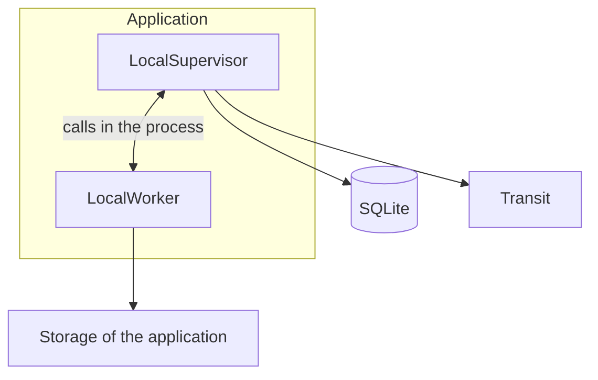
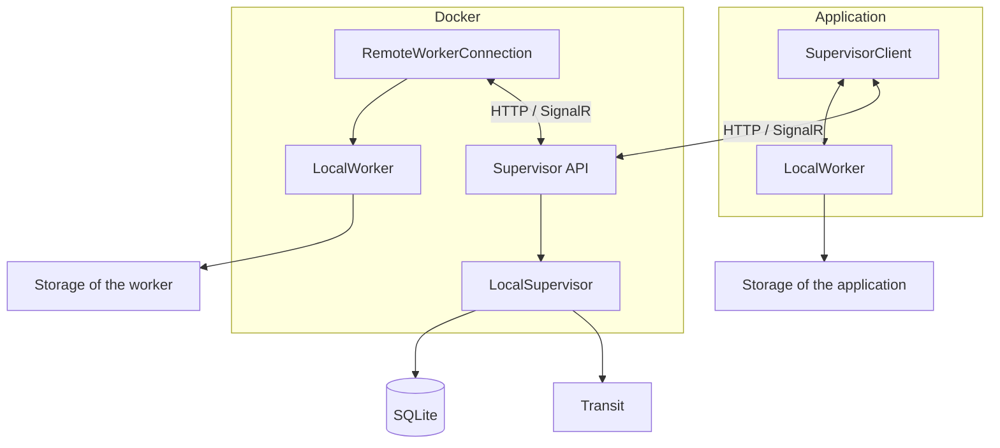
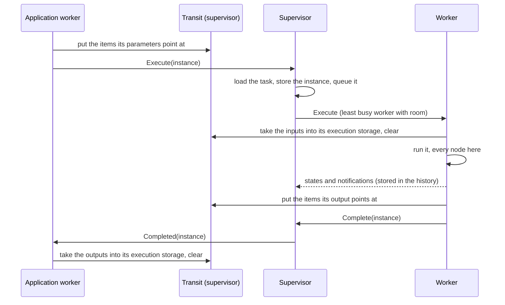
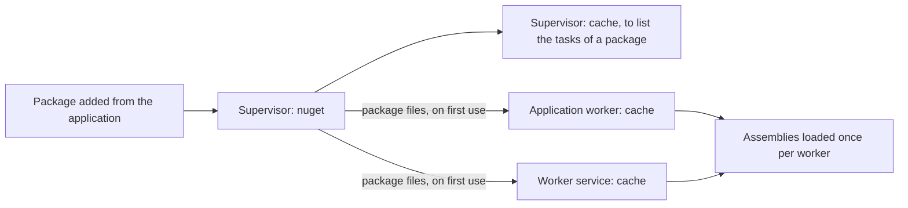

# Architecture

The standalone and remote modes run the same code: one supervisor (`LocalSupervisor`) and one kind of worker (`LocalWorker`). A remote supervisor only adds an HTTP/SignalR layer between them, and a remote worker only adds a hub connection.

Two rules keep the interactions simple:
- Once an execution is on a worker, it stays there: every node of a workflow sent to a worker runs on that worker.
- Only an execution started in the application sends nodes to a worker (intensive tasks, specific authorizations, ...).

## Standalone and remote

In standalone mode, the supervisor runs inside the application, and the application is its only worker.



In remote mode, the application reaches the supervisor through its API, and the supervisor dispatches to the remote workers.



| | Standalone | Remote |
| --- | --- | --- |
| Supervisor | `LocalSupervisor` in the application | `LocalSupervisor` behind `Fantoche.Supervisor.Api`, reached with `SupervisorClient` |
| Transport | Calls in the process, messages copied as over the wire | HTTP for the data, SignalR hubs for the executions and the history |
| Workers the supervisor dispatches to | The application | The worker services (`Fantoche.Worker.Service`) |
| A node set to "Run on a worker" | Runs on the application, in an execution of its own | Runs on a worker service |

Both supervisors implement `ISupervisor`, which is all the application and the workers know of them. That is why the mode only changes how the application is built (`SpineViewModel.AddServices`), never what it does.

In the process, the messages are copied the way the wire would copy them (`FantocheJson.Copy`). The caller and the worker never share an instance, so a bug can't hide in one mode only.

## A node sent to a worker

Each worker only reads its own storage. The tables and files a node needs therefore travel with it, through the transit of the supervisor:



- **What travels.** `StorageTransfer` finds the tables (`t_<id>`) and files (`f_<id>`) anywhere in the parameters or the output, by their id. Only those are copied, never the whole storage.
- **Ids never change.** Tables and files are immutable, so a copy keeps its id, and the `TableRef` or `FileRef` in the JSON stays valid. An item that is already there isn't copied again.
- **The transit is emptied.** Each side clears what it took. The supervisor also clears the transit of a caller that disconnects, and empties all of it when it starts: executions only live in its memory, so none survive a restart.

## Storage and retention

Each worker, the application's included, keeps one storage folder per execution it runs. The nodes of a workflow write into the folder of its run.

```text
storage/
  {taskId}/
    {created}-{instanceId}/
      tables/t_{id}.parquet
      files/f_{id}/{name}
```

Only the last executions of each task or workflow keep their folder: 10 by default, set on the task or the workflow ("Executions keeping their storage", `TaskSettings.StorageRetention`). Each worker applies this to its own folders:
- The older folders are deleted when an execution ends, but never the folder of an execution still running.
- The count is taken from the task or workflow the execution started from. On a worker, that is the node it was sent.

A table or file named in the history therefore only exists on the worker that wrote it, and only while it is within the retention count.

## Workers and pending executions

The supervisor keeps its executions in memory only, so it pushes what it dispatches rather than storing it (`ISupervisor.Dispatch`):
- The `Dispatcher` raises `StatusChanged` with the whole status whenever a worker comes or goes, or an execution is queued, handed out or over.
- In remote mode, the supervisor API pushes it on the `hubs/dispatch` hub, and `GET /dispatch/status` reads it. After a reconnection, the client reads it again: what was pushed meanwhile is lost.
- The Workers page reads the status once when shown, then follows the changes until hidden. It shows each worker with what it runs, and the executions waiting for room, in the order they will be handed out.
- The application is always listed first. Its executions started in the application run on its own worker without going through the supervisor, so the page reads them from the execution service (`IExecutionService.RunningChanged`). In standalone mode, the application is also the supervisor's worker: both are shown as one row.

## Packages and caches

The supervisor holds the packages. Each worker downloads a package the first time a task needs it, and extracts it in its own cache:



- A cache never refreshes a version it already extracted, so a version can't be added twice. Publish a changed package under a new version.
- The supervisor's cache only serves to check what a package holds when it is added. The tasks themselves always run from the cache of a worker, in both modes.

## Folders

```text
Supervisor (DATA_FOLDER, or %AppData%/Automation in standalone mode)
  fantoche.db       database: scopes, tasks, workflows, history
  nuget/            the packages added
  cache/            the packages extracted to check what they hold
  transit/          the storage on its way between a caller and a worker

Worker (DATA_FOLDER, or %AppData%/Automation/worker for the application)
  cache/            the packages extracted to run the tasks
  storage/          the storage of its executions
```
