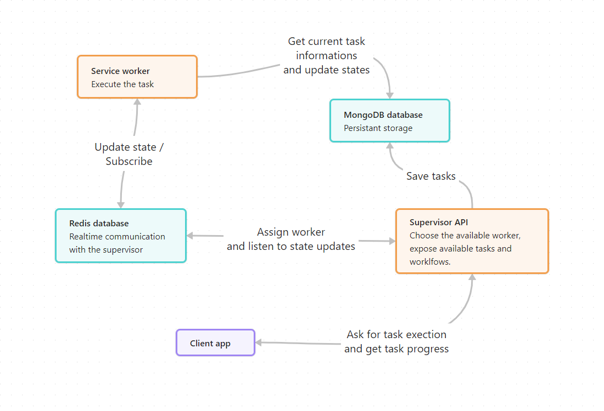

# Fantoche
No-code solution to create workflow automation based on a node editor.

Objectives:

- Create tasks based on various technical packages.
- Create workflows composed of tasks and sub-workflows connected to each other.
	- During the execution of a workflow, pass the result of a node to each connected node.
	- Flexible data handling while still supporting typed task results.
- Order tasks and workflows by scopes.
- Provide context on scope, tasks, and workflows to allow complex settings.

Backend Requirements:

- One supervisor that handles comms between clients and workers. Supervisor is an unique entry point for simplification sake.
- Workers that can be horizontally scaled to execute tasks.
- Fast real-time communication between workers and supervisor (as opposed to loops with delays).

## Architecture

## Getting started

1. Start the `docker-compose` startup project (or `Fantoche.Supervisor.Api` and `Fantoche.Worker.Service`).
2. Start `Fantoche.App`, and set the supervisor address and the shared storage folder in its settings (gear of the title bar).

### Modes

- **Supervisor** (default) : the supervisor holds the database, the application and the workers reach it through its API. A task or a workflow set to "Run on a worker" is sent to a worker, the rest runs in the application. A workflow is handed whole to a single worker.
- **Standalone** : the application keeps its own database, packages and storage, and has no worker (a task set to run on one fails). Only for debugging or very particular uses.

The mode, the supervisor and the shared storage folder are applied when the application starts.

### Configuration

- Supervisor : `DATA_FOLDER` (its database, the `nuget` packages and their cache).
- Worker : `SUPERVISOR_URL`, `WORKER_ID`, `WORKER_CAPACITY` (executions run at once), `DATA_FOLDER` (the cache of the packages) and `SHARED_FOLDER`.
- The packages are added to the supervisor, which serves them : a worker, or the application running a task itself, downloads a package the first time it needs it and extracts it in its own cache. A version can't be added twice, since the caches would keep the first one : publish a changed package under a new version.
- The shared folder holds the `storage` (tables and files). The workers and the application all reach it : everything flows between tasks through their parameters or the storage. Tasks writing the same data at once is for the workflow to avoid.

The supervisor has no authentication yet.

## Links

- [Adonis UI](https://benruehl.github.io/adonis-ui/) for styles
- [Fontawesome](https://fontawesome.com/) icons
- [PropertyChanged.Fody](https://www.nuget.org/packages/PropertyChanged.Fody) for boilerplate
- [Nodify](https://miroiu.github.io/nodify/) for the node editor

# TODO

- Scripting language to handle contexte change in tasks settings
- Generic way to create UI form for settings
    - Also handle validation and types with this ?
- Handle supervisor edge case for flow control tasks
- Add user management with roles and permissions
- Handle proper state (going back and forth with history) in the editor
- handle read and write tasks in the interface
- Supervisor

- Display workers list and allow supervision
- Workflow validation with potential errors prompting (infinite loop. dead branches, ...)

# ToThink

- Allow multiple supervisor and more complex worker assignation
- Re-dispatch the executions of a lost worker rather than failing them
- Resume a workflow after a crash (would need the previous instance and the shared context to be stored)
- display potential errors in workflow creation