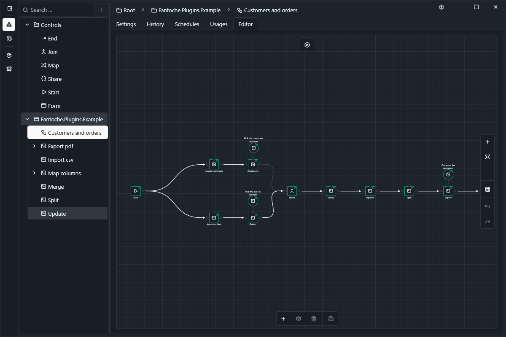

# Fantoche

No-code workflow automation built around a node editor.



Tasks come from NuGet packages and are connected into workflows, where each node passes its result to the nodes that follow it. Workflows can contain sub-workflows, and both are organized by scope. A supervisor dispatches executions to workers that can be scaled horizontally, and the desktop application is used to edit, start and follow them.

The application is also a worker of its own: what it starts runs on the machine of the user, close to their files and without going through the network, unless it is started on the remote workers. Heavy workflows can run locally for performance, and the workers keep the scheduled and long-running ones.

For the technical details (standalone and remote modes, where an execution runs, storage, packages and their caches), see [architecture.md](architecture.md).

## Getting started

1. Build the NuGet packages of the example tasks and of their interfaces, from the `Fantoche` folder:

   ```bash
   dotnet pack Fantoche.Plugins.Example -c Release -o packages
   ```

   ```bash
   dotnet pack Fantoche.Plugins.Example.Ui -c Release -o packages
   ```

2. Start `Fantoche.App`, open the **Packages** page and add `Fantoche.Plugins.Example`, then `Fantoche.Plugins.Example.Ui` from the `packages` folder.
3. Check out what they created: the table tasks and the **Customers and orders** workflow, in a scope named after the package. Generate input files with `Fantoche.Plugins.Example/Resources/Samples/generate-test-data.ps1`, then open the workflow and start it with their paths. See [the table tasks](Fantoche/Fantoche.Plugins.Example/readme.md).

### Standalone and remote supervisor

By default, the application runs standalone: the supervisor runs inside the application, which is its only worker. Nothing else needs to be started.

To use a remote supervisor and its workers:

1. Start them with Docker, from the `Fantoche` folder (or start `Fantoche.Supervisor.Api` and `Fantoche.Worker.Service`). The supervisor listens on `http://localhost:8080`.

   ```bash
   docker compose up -d --build
   ```

2. In the application settings (gear of the title bar), uncheck **Standalone** and set the **Supervisor address**.
3. Restart the application: the mode and the supervisor are applied when it starts.

## Built with Joufflu

The WPF application uses [Joufflu](https://www.nuget.org/packages/Joufflu) for its controls, styles, theme and generated forms (`Joufflu.Data`, `Joufflu.Inputs`, `Joufflu.Navigation`, `Joufflu.Feedback`). Task interfaces shipped in packages share the application's Joufflu, so they must reference the same version or an older one.
